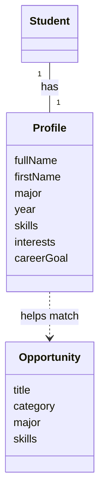
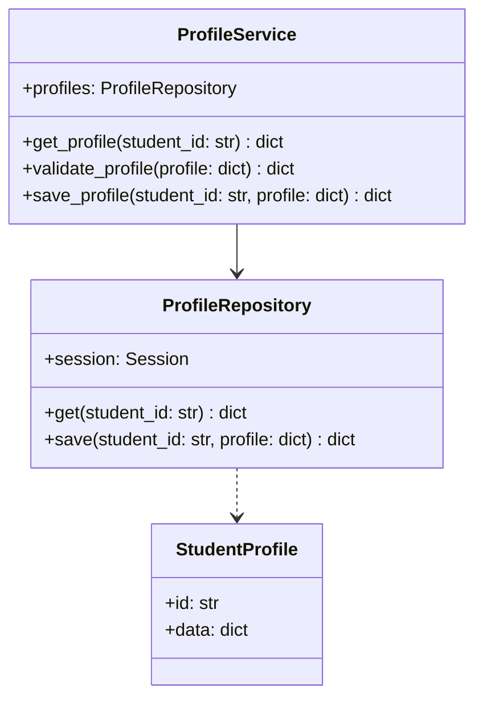
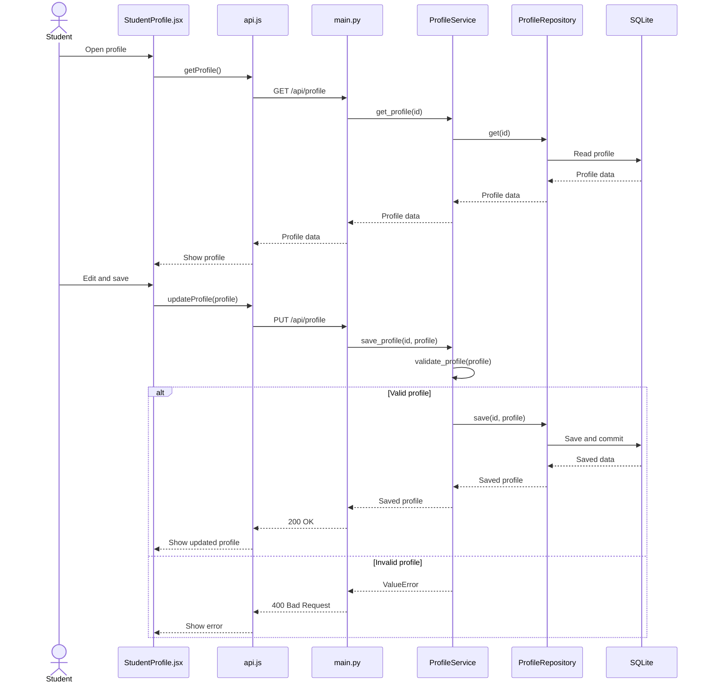
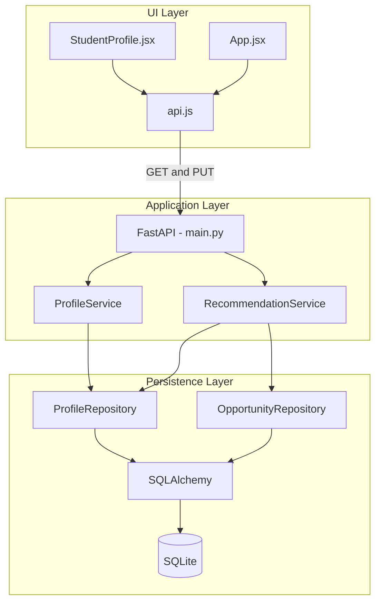

# Deliverable 4 - Student Profile Diagrams

**Author:** Ridha Mahmood  
**Project:** MasonCompass

## 1. Conceptual Class Diagram

A student has a profile. The profile helps find matching opportunities.

## 2. Detailed Class Diagram

ProfileService checks the profile. ProfileRepository reads and saves it. StudentProfile stores the data.

The get methods can return None if the profile is missing. The types show what each method uses or returns.

## 3. Sequence Diagram

The student opens the profile, edits it, and saves it. The backend checks the changes before saving them.

## 4. Layered Architecture Diagram

The UI sends requests to the backend. The business logic checks the data, and the database stores it.

Recommendations use the saved profile when the student opens the Recommendations page again.

## Source Code

| File | Purpose |
| --- | --- |
| [StudentProfile.jsx](../frontend/src/components/StudentProfile.jsx) | Display and edit profiles |
| [api.js](../frontend/src/api.js) | Send API requests |
| [main.py](../backend/main.py) | Handle requests |
| [services.py](../backend/services.py) | Check profile information |
| [repositories.py](../backend/repositories.py) | Read and save data |
| [database.py](../backend/database.py) | Shared database setup |
| [test_services.py](../backend/test_services.py) | Test business logic |
| [App.jsx](../frontend/src/App.jsx) | Load recommendations |

## Testing and Review

- All six unit tests passed, including five profile tests and one recommendation test.
- The profile saved successfully, and recommendations changed after editing it.
- The current MVP uses one demo student.
- Peer approval: Pending.
