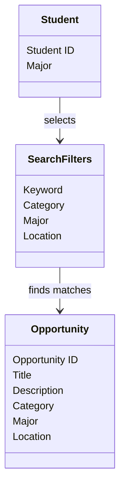
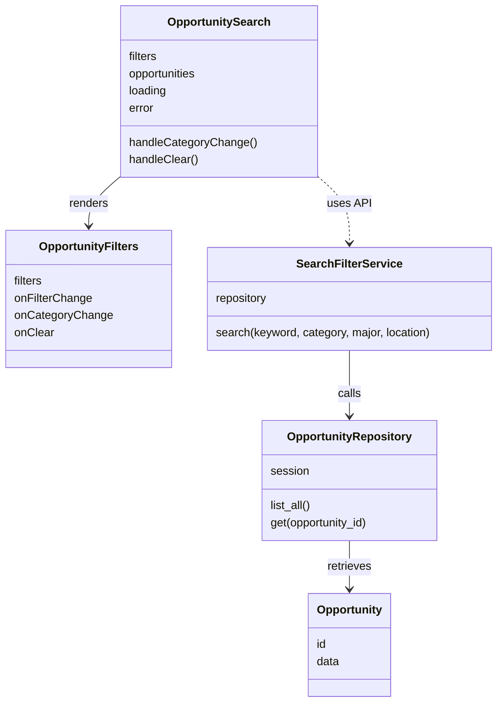
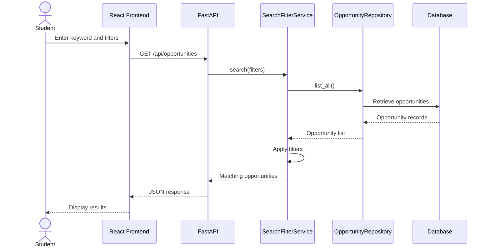
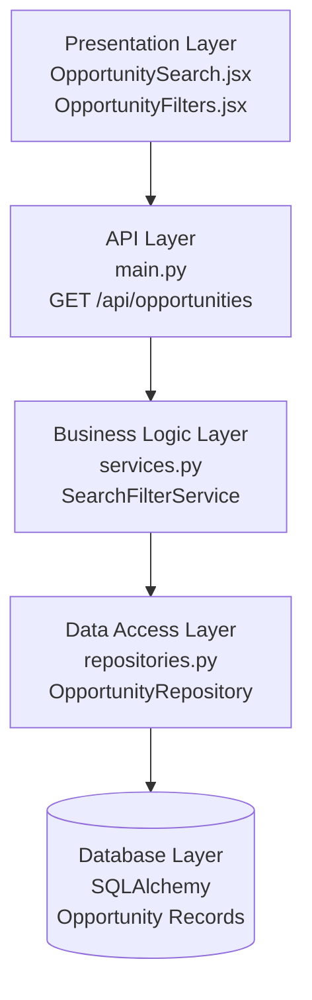

# Search & Filtering — Design Diagrams

**Project:** MasonCompass  
**Deliverable:** 4  
**Feature:** Opportunity Search & Filtering  
**Contributor:** Sadia

## 1. Conceptual Class Diagram

This diagram shows the main concepts involved in searching for opportunities.

## 2. Detailed Class Diagram

This diagram shows the components and classes used to implement the feature.

## 3. Sequence Diagram

This diagram shows what happens when a student searches for an opportunity.

## 4. Layered Architecture Diagram

This diagram shows how the different parts of the feature work together.

## Design Summary

The Search & Filtering feature follows a layered design.

The React frontend collects the student's search keyword and filter selections. FastAPI receives the request and passes the information to SearchFilterService.

SearchFilterService uses OpportunityRepository to retrieve opportunities from the database and returns the matching results.

This separation makes the feature easier to maintain and test.

## Review Status

Reviewed by Trey Irizarry

approved
