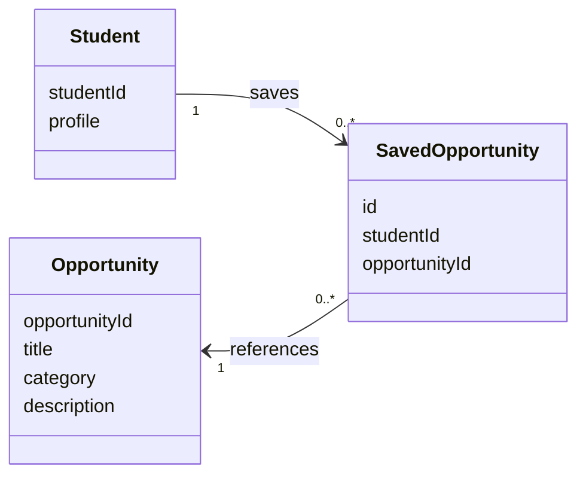
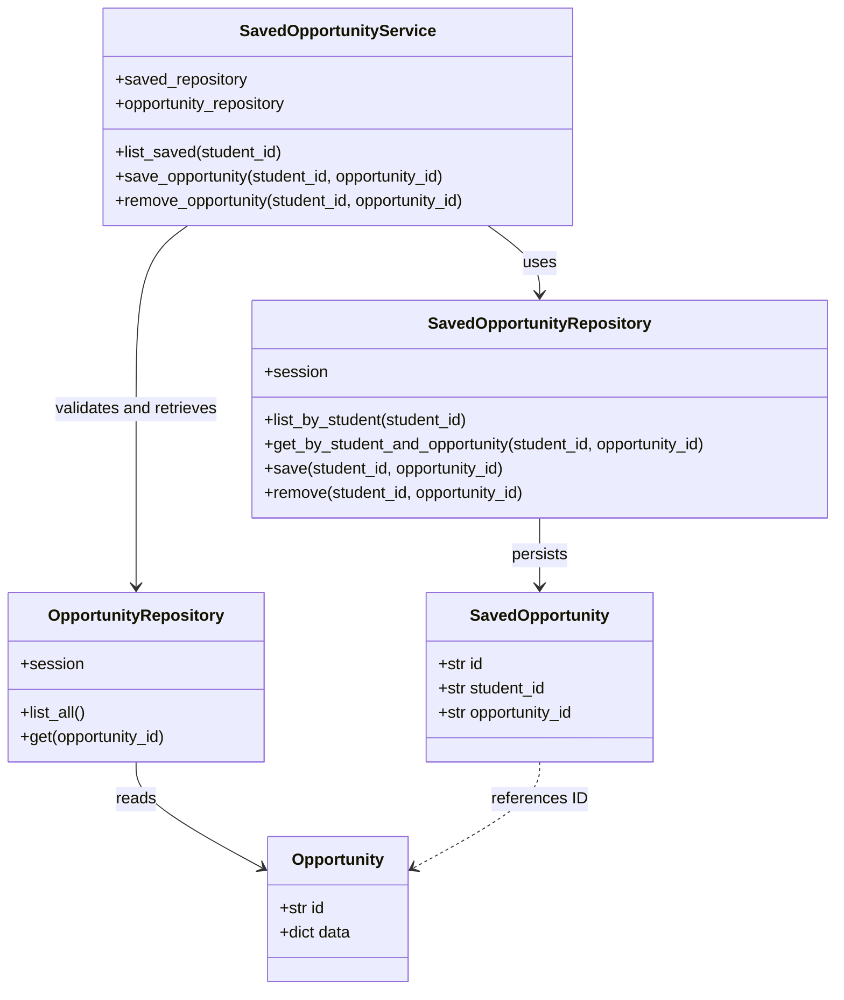
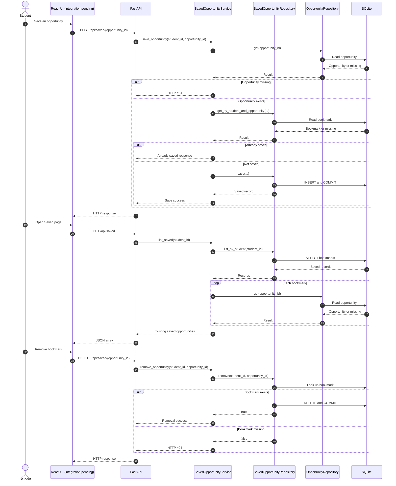
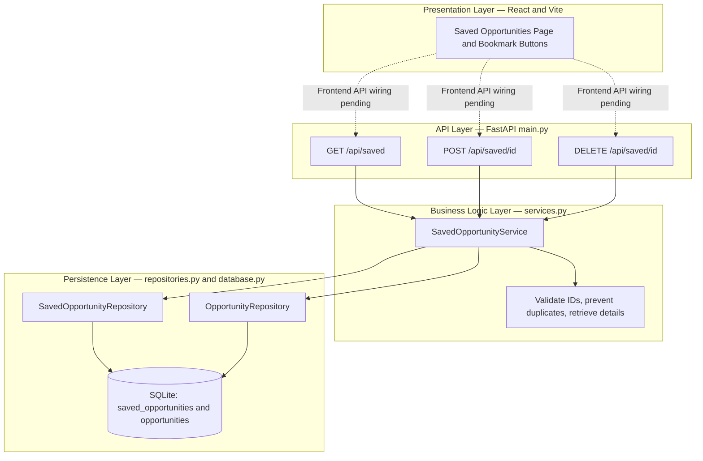

# Saved Opportunities — Design Diagrams

**MasonCompass | CS 321 | Deliverable 4**  
**Contributor:** Taj Dhaliwal  
**Status:** Backend code implemented and shared for integration; runtime testing, frontend API wiring, and peer review pending.

## 1. Conceptual Class Diagram

The conceptual model associates students with opportunities through bookmark records. The relationships are logical; the current database model stores IDs without explicit foreign-key constraints.

## 2. Detailed Class Diagram

This diagram reflects the classes and methods added to the existing backend. The `SavedOpportunity` table uses a string ID plus student and opportunity identifiers.

## 3. Sequence Diagram

The API operations are implemented in `main.py`. React-to-API calls are the intended integration path and remain unverified.

## 4. Layered Architecture Diagram

Solid connections represent implemented backend calls. Dashed connections represent frontend wiring that still requires integration and testing.

## Implementation Notes

- The backend uses `DEMO_STUDENT_ID = "demo-student"` while authentication is outside the current MVP scope.
- Saving checks whether an opportunity exists and whether it has already been bookmarked.
- Listing retrieves the current opportunity data for each saved ID, skipping records whose opportunities are no longer present.
- Removing a nonexistent bookmark returns HTTP 404.
- The existing React Saved page still needs to call these endpoints for bookmarks to persist across refreshes.
- The implementation has not yet been runtime-tested or peer-reviewed; the diagrams describe the submitted backend code and intended frontend integration.
