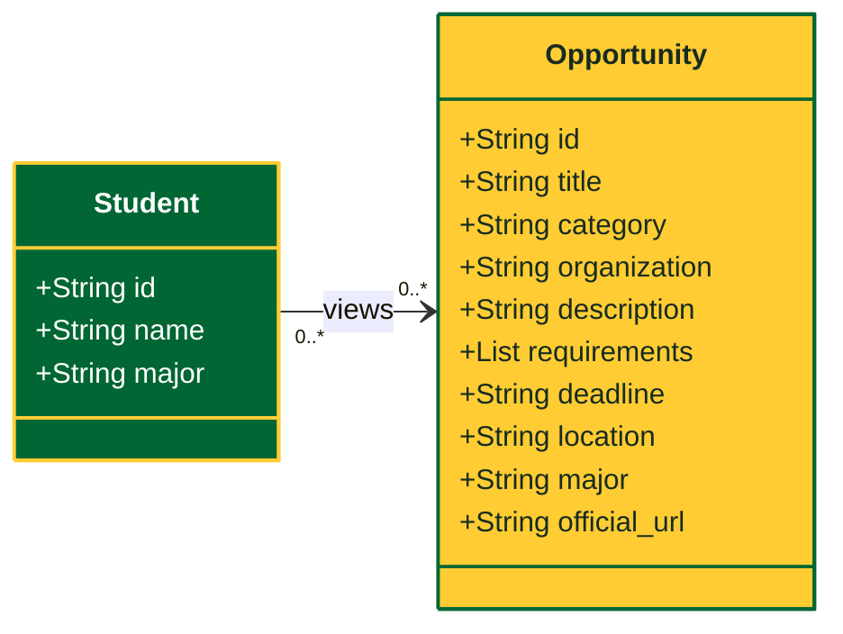
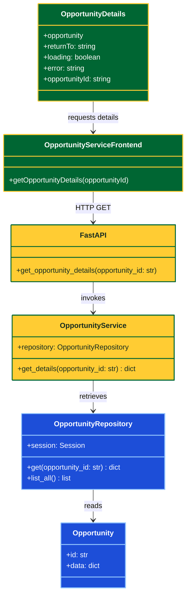
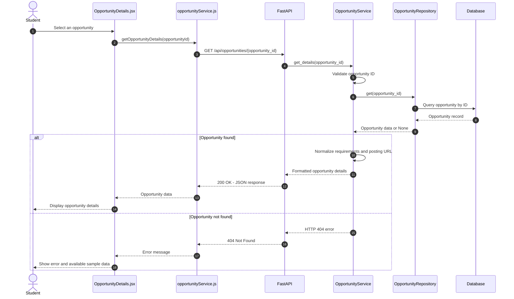
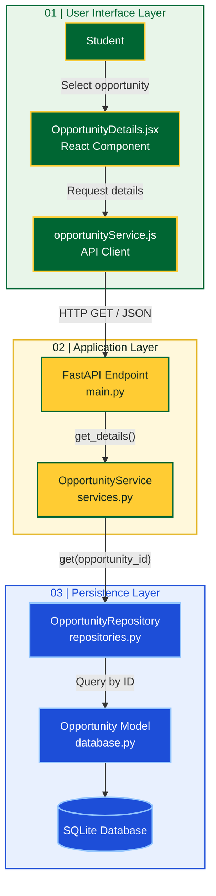

# MasonCompass | Internship Opportunity Discovery

**CS 321 – Deliverable 04**  
**Author:** Trey Irizarry  
**Feature:** Internship Opportunity Discovery

---

## 1. Conceptual Class Diagram

---

## 2. Detailed Class Diagram

---

## 3. Sequence Diagram

---

## 4. Layered Architecture Diagram

---
